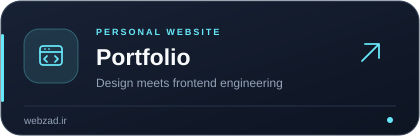
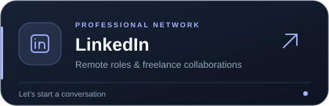

<h1 align="center">
  
  Mohamadmahdi Tajkarimi
</h1>

  <strong>Frontend Developer &amp; UI/UX Designer</strong> 
  Thoughtful design. Precise interfaces. Reliable implementation.

  5 YEARS OF FREELANCE EXPERIENCE &nbsp; · &nbsp; OPEN TO REMOTE WORK

  
  &nbsp;
  

## About

I’m a frontend developer and UI/UX designer with **five years of freelance experience**, connecting product requirements, visual design, and working interfaces. I take ownership of frontend delivery — from understanding the client’s needs to refining the experience and verifying the result.

My core stack is **React, Tailwind CSS, and Laravel**. I also work with **Vue.js and Next.js**, and have developed backend functionality when projects required it. My focus is on precise, responsive interfaces that work naturally with real content, different screen sizes, and right-to-left languages.

<h2> Expertise</h2>

<table>
  <tr>
    <td width="50%" valign="top">
      <strong>Interface Design &amp; UX</strong> 
      Clear user flows, considered visual hierarchy, and interaction details carried through to implementation.
    </td>
    <td width="50%" valign="top">
      <strong>Frontend Engineering</strong> 
      React development and precise Tailwind CSS layouts, with responsive behavior and RTL support built in.
    </td>
  </tr>
  <tr>
    <td width="50%" valign="top">
      <strong>Backend Development</strong> 
      Laravel as my primary backend framework, with Next.js experience when the project calls for it.
    </td>
    <td width="50%" valign="top">
      <strong>Testing &amp; Delivery</strong> 
      Functional verification and automated tests to check important workflows and build confidence in delivery.
    </td>
  </tr>
</table>

## Technology

<table>
  <tr>
    <td valign="middle"><strong>Core stack</strong></td>
    <td>
       
      React · Tailwind CSS · Laravel
    </td>
  </tr>
  <tr>
    <td valign="middle"><strong>Languages &amp; foundations</strong></td>
    <td>
       
      TypeScript · JavaScript · PHP · HTML · CSS
    </td>
  </tr>
  <tr>
    <td valign="middle"><strong>Additional frameworks</strong></td>
    <td>
       
      Next.js · Vue.js
    </td>
  </tr>
</table>

<h2> Background &amp; Education</h2>

I started freelancing at **thirteen**, learning through real projects and direct client collaboration. That early start shaped how I work today: communicate clearly, learn independently, and take responsibility for the result.

I’m currently pursuing a degree in **computing at Imam Sadegh University in Babol**, a public university in Iran, alongside my professional work.

## Collaboration

I’m open to **remote frontend roles** and **freelance projects** that value both thoughtful UI/UX and careful implementation. I bring a practical approach to collaboration: understand the problem, make deliberate decisions, and keep the client’s goals in view.

**[Explore my website ↗](https://www.webzad.ir)** &nbsp; · &nbsp; **[Let’s connect on LinkedIn ↗](https://www.linkedin.com/in/mohamadmahdi-tajkarimi-a37519245/)**
